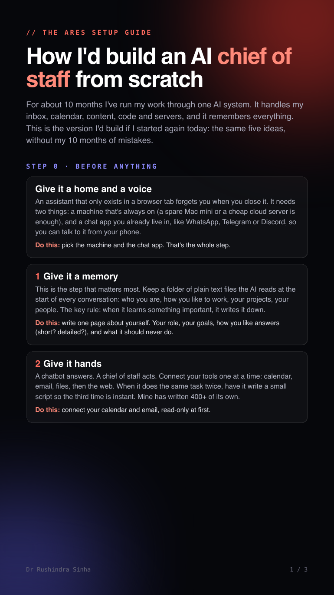
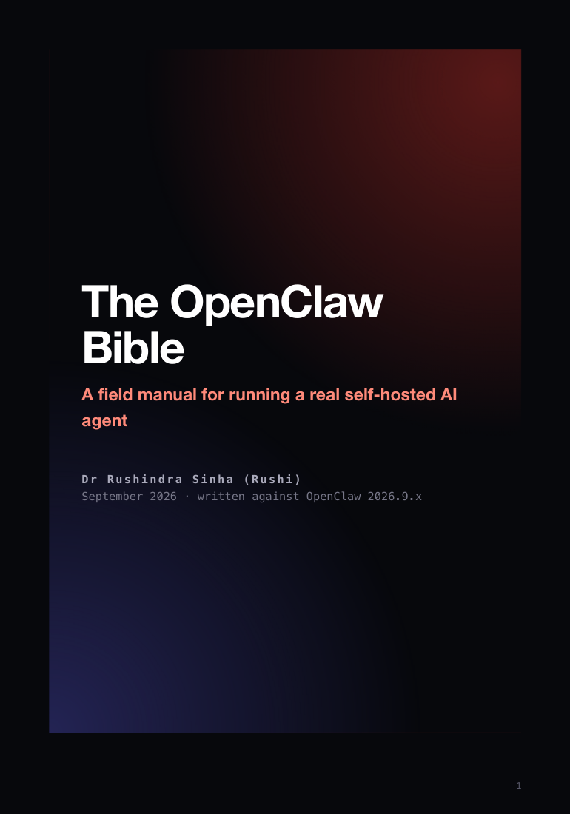
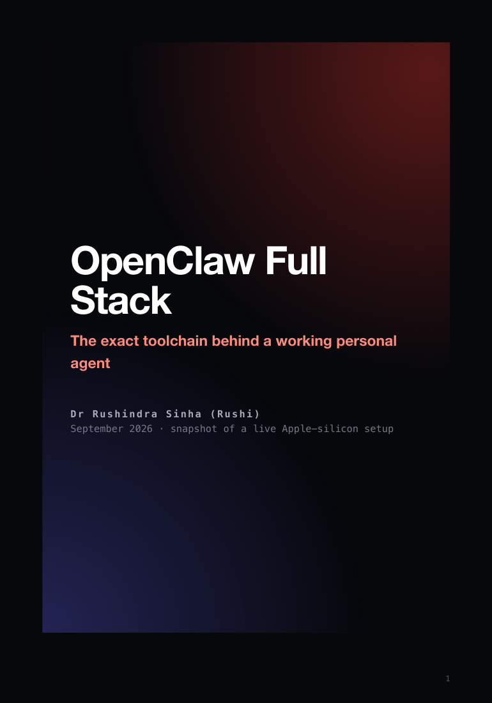

<p align="center">
  
  
  
</p>

<h1 align="center">OpenClaw Guide</h1>

<p align="center">
  <strong>How I run a real self-hosted AI chief of staff, and how you can build your own.</strong>
</p>

<p align="center">
  By <a href="https://x.com/irushi">@irushi</a>, from running my agent Ares every day across WhatsApp, Discord and a fleet of seven machines.<br/>
  <em>Updated September 2026 for OpenClaw 2026.9.x.</em>
</p>

<p align="center">
  <a href="./start-here/ai-chief-of-staff-starter.pdf"><b>Start here (3 pages)</b></a> •
  <a href="./openclaw-bible.pdf">OpenClaw Bible (21 pages)</a> •
  <a href="./openclaw-full-stack.pdf">Full Stack (7 pages)</a> •
  <a href="https://docs.openclaw.ai">OpenClaw Docs</a>
</p>

---

## Which one should I read?

| If you… | Read |
|---|---|
| saw my post and want the idea in 5 minutes, no code | **[Start here: How I'd build an AI chief of staff from scratch](./start-here/ai-chief-of-staff-starter.pdf)** |
| are ready to set up OpenClaw properly | **[The OpenClaw Bible](./openclaw-bible.pdf)** |
| want the exact tools, models and services behind my setup | **[OpenClaw Full Stack](./openclaw-full-stack.pdf)** |

## What's inside

### 1) Start here: AI chief of staff starter (3 pages)
The five ideas that turned a chatbot into a chief of staff, a first-week plan, what not to automate yet, and the mistakes I made. No code.

### 2) The OpenClaw Bible (21 pages)
The field manual. Every chapter has **the setup** (how OpenClaw works today) and **the lesson** (what running it for real taught me):
- installing and onboarding (reusing your Claude login)
- the workspace and the **Soul Stack** (`SOUL.md`, `AGENTS.md`, `USER.md`, `MEMORY.md`)
- channels, and what each one is good for
- secrets without ever pasting a key into chat
- models, thinking levels and cost
- **security**: permission modes, kill switches, and the lock-down-then-loosen method
- skills, automations, heartbeats and memory
- multiple agents and running a fleet of machines
- what breaks and how to fix it

### 3) OpenClaw Full Stack (7 pages)
A snapshot of the live toolchain: core install, Claude plus local models (Ollama, Whisper), CLI tools, Node and Python packages, memory (including GBrain), the skills that earn their keep, background health services, and a fresh-install order.

## The 5 ideas that matter most

1. **Give it a memory.** Plain files it reads every session, plus a knowledge graph once it grows. If it isn't written down, it didn't happen.
2. **Give it hands.** Tools, skills and scripts, so it acts instead of just answering.
3. **Put it on a schedule.** Automations are what turn an assistant into a chief of staff.
4. **Make it learn from mistakes.** Every error becomes one line in a rules file.
5. **Keep the final say.** Draft anything; send, post, pay or delete only with your approval.

## Quick start

```bash
npx openclaw@latest            # or: curl -fsSL https://openclaw.ai/install.sh | bash
openclaw gateway install       # keep it running in the background
openclaw gateway status
openclaw dashboard
```

Then:
1. write your `SOUL.md` and `USER.md`
2. set shell commands to `ask` mode and run `openclaw security audit`
3. connect one channel (your own chat)
4. turn on one automation: a morning brief
5. check it end to end: message it from your phone and get a real answer

## Related repos

- [ares-skills](https://github.com/rushindrasinha/ares-skills): production-tested OpenClaw skills
- [skill-audit-router](https://github.com/rushindrasinha/skill-audit-router): find out which of your agent's skills it can actually find
- [ares-mbl](https://github.com/rushindrasinha/ares-mbl): make other models behave more like Claude
- [openclaw-mac](https://github.com/rushindrasinha/openclaw-mac): one-command Mac setup

## Building the PDFs

The PDFs are generated from the Markdown in [`guides/`](./guides) and the HTML in [`start-here/`](./start-here). Edit those, then run `./build.sh` (needs `pandoc` and Google Chrome).

## Changelog

See [CHANGELOG.md](./CHANGELOG.md).

## Usage

These docs are public so builders can learn from and adapt the setup. If you build something from this, tag me. I want to see what you make.
